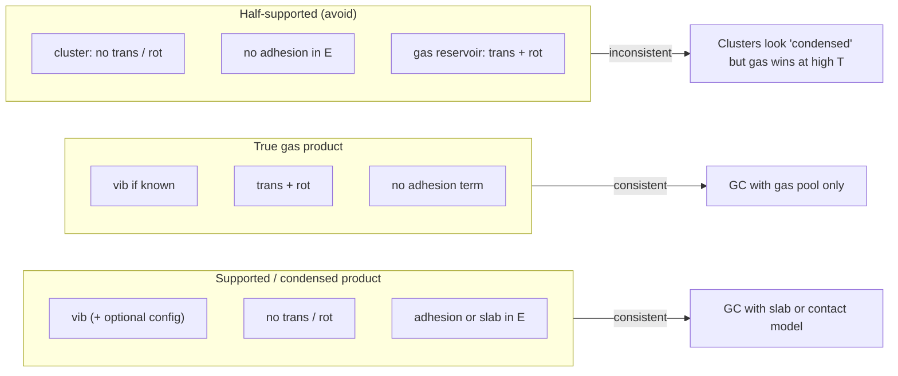

# Grand-canonical thermodynamics: support proxy, gas reservoir, and literature framing

This note complements [methodology_clustering_and_thermodynamics.md](methodology_clustering_and_thermodynamics.md). It explains how we treat **supported IrOₓ nanoparticles** in a GC ensemble with an **IrO₂ / IrO₃ gas reservoir**, how that maps onto the **Reichenbach / Kempen** ab-initio thermodynamic design (AITD) line of work, and what those papers do **not** claim. It also documents the **half-supported inconsistency** and the figure-layer corrections in `figures/config.py`.

**Code**

| Topic | Module |
|-------|--------|
| Gas reservoir merge + thermo patches | `figures/utils/gc_gas_oxides.py` |
| Support-stabilization proxy | `figures/utils/gc_support.py` |
| Cache orchestration | `figures/utils/cache.py`, `figures/utils/rutile_gc_cache.py` |
| Switches | `figures/config.py` |

---

## 1. Thermodynamic regimes (supported vs gas vs half-supported)

In ab-initio thermodynamics of adsorbates and supported clusters, **translational and rotational partition functions on the product species** mark a **gas-phase molecule**. Species treated as **adsorbed, supported, or bulk-like condensed** normally carry **vibrational** (and possibly configurational) entropy only—their centre-of-mass motion is quenched by the support or by cooperative interactions with an extended environment.

| Regime | Product geometry | Trans / rot on product | Vibrations on product | Explicit support / adhesion in *E* | Gas reservoir (IrO₂, IrO₃) |
|--------|------------------|------------------------|------------------------|-----------------------------------|----------------------------|
| **Supported cluster** (Reichenbach, Kempen) | On slab or in contact with oxide | **Off** | On (Helmholtz / harmonic) | **Yes** — slab + contact counting, bulging penalties | On — μ from reservoirs with full gas thermo |
| **True gas phase** | Gas-phase minimum | **On** | On (if known) | No | Same species; full gas thermo |
| **Half-supported** (inconsistent) | Gas-phase IrO₂ / IrO₃ geometry | **Off** (like supported) | Cluster: on (PBE); gas in pool: often on | **No** | **On** — reservoir molecules get rot/trans |

**Consistency rule**

- **No rot and no trans on the product** should imply either **(i)** an explicit support / adhesion term in the energy, or **(ii)** some other external interaction that anchors the cluster (slab, solvent cage, strong adsorption site, …).
- **Rot and trans on the product** should imply a **true gas-phase** treatment (or a very weakly bound precursor treated as gas).
- **Violating both directions at once** — gas geometries, no rot/trans on clusters, no adhesion, but a gas reservoir whose rows **do** get rot/trans — creates a **half-supported** model that **systematically favours evaporation** into the reservoir.



Our IrOₓ pool uses **freestanding cluster DFT** (no CeO₂ or IrO₂ slab) plus an **IrO₂ / IrO₃ trace-gas reservoir**. That is physically closer to the **middle column of the inconsistency**: clusters inherit the **supported-style** product flags from `GCConfig` (`include_r_product = include_t_product = False`), while gas rows were patched with **full gas rot/trans** at fixed trace pressure (`GC_GAS_P = 1 Pa`).

---

## 2. What Kempen & Andersen (npj Comput. Mater. 2025) **does** say

Kempen et al. extend the Reichenbach AITD framework for **supported suboxide clusters** (Zn_yO_x on Cu(111) in the published examples). Points that transfer directly to our **Methods** wording:

1. **Supported clusters use a condensed-species partition function** — harmonic / Helmholtz vibrational terms on the cluster; **no translational or rotational entropy on the supported product** (same design as Reichenbach et al., J. Phys. Chem. C **2019**, 123, 29214–29227; doi [10.1021/acs.jpcc.9b07715](https://doi.org/10.1021/acs.jpcc.9b07715)).

2. **Gas-phase reservoirs** enter through **chemical potentials** μ(T, P) with **full gas thermodynamics** (including rot/trans where appropriate).

3. **Support is not a scalar fudge factor** — it enters through **explicit cluster–slab models**, **metal–support contact counts**, and **penalties when local geometry bulges away from the surface** (eV-scale rearrangements; breaking a Zn₃O tripod contact ≥ **0.6 eV** in their Zn/Cu(111) example).

4. **Supported vs freestanding phase diagrams differ** — the ChemRxiv PtOₓ/CeO₂ work (Quinlivan Domínguez, Neyman, Bruix, 2021) shows the same qualitative split: anchoring changes which basin is global minimum at a given (T, μ_O₂).

---

## 3. What Kempen **does not** say (do not over-cite)

| Claim | Safe? |
|-------|-------|
| “Supported clusters omit trans/rot; gas reservoirs use μ with gas thermo” | **Yes** — methodological precedent |
| “Support–cluster interaction is eV-scale when contacts break” | **Yes** — qualitative, with Reichenbach/Kempen numbers for **Zn/Cu**, not Ir |
| “Use **0.65 eV per Ir** as the Kempen adhesion energy for IrOₓ” | **No** — not in Kempen; not measured for Ir on an oxide here |
| “Freestanding IrOₓ gas minima + no trans/rot + gas reservoir = Kempen-supported GC” | **No** — missing slab / contact physics |
| “Fixed 1 Pa IrO₂ / IrO₃ pressure is experimentally calibrated” | **No** — it is a **trace-gas** numerical choice; rutile supp uses the same order of magnitude for bulk comparison |

The **0.65 eV/Ir + 0.05 eV/O** support proxy in `figures/config.py` is a **phenomenological restore** of the missing anchoring half of the half-supported model, **not** a DFT-derived Ir–oxide adhesion energy. Reichenbach/Kempen justify **that such a correction belongs in the energy**, not **this numeric value**.

---

## 4. How to cite in the Ir/O paper

**Suggested Methods paragraph (adapt wording):**

> Grand-canonical assembly follows ab-initio thermodynamic design as in Reichenbach et al. and Kempen et al.: supported nanoparticles are treated as **condensed products** (harmonic vibrations, **no** centre-of-mass translation or rotation), while O₂ and trace IrO₂ / IrO₃ reservoirs enter through μ(T, P) with **gas-phase** partition functions. Our IrOₓ structures are **freestanding DFT minima** without an explicit oxide slab; to avoid an inconsistent limit in which clusters are thermodynamically condensed but not energetically anchored, we apply a **uniform stabilization** ΔG_support = −(ε_Ir n_Ir + ε_O n_O) to cluster rows only (ε_Ir = 0.65 eV, ε_O = 0.05 eV), leaving gas-reservoir rows unchanged. IrO₂(g) and IrO₃(g) are included at fixed trace partial pressure P = 1 Pa. We regard ε_Ir as a **sensitivity parameter** motivated by contact-loss penalties in supported suboxide literature, not as a fitted Ir–support adsorption energy from this work.

**References to cite together**

- Reichenbach et al., JPCC 2019 — AITD, ZnO_x/Cu(111), μ vs condensed clusters.
- Kempen & Andersen, npj Comput. Mater. 2025 — inverse catalyst design; supported-cluster partition functions; bulging/contact penalties.
- Optional context: Quinlivan Domínguez et al., ChemRxiv 2021 — supported vs freestanding PtOₓ on CeO₂ phase diagrams.

**Bonus quotable facts (Zn/Cu examples in Kempen/Reichenbach — not Ir numbers)**

- Zn atom adsorption on Cu(111): **−1.19 eV** (Reichenbach).
- Breaking a three-fold Zn–Cu contact when a Zn₃O tripod lifts: **≥ 0.6 eV** (Kempen).
- Bulging away from the surface **reduces** metal–support coordination; GC free energy includes that loss explicitly in slab models, not via rot/trans on the cluster.

---

## 5. Production settings vs sensitivity tests

**Production defaults** (after support + gas-reservoir work):

```python
GC_GAS_P = {"PBE": 1.0, "PBE0": 1.0}
GC_GAS_INCLUDE_VIB = True          # gas rows: vib/ZPE if present in run_gc baseline
GC_GAS_INCLUDE_ROT_TRANS = True    # patch rot/trans onto gas rows only
GC_APPLY_SUPPORT_STAB = True
GC_SUPPORT_STAB_EV_PER_IR = 0.65
GC_SUPPORT_STAB_EV_PER_O = 0.05
RUTILE_GC_GAS_P = 1.0
RUTILE_GC_GAS_USE_VIB = False
RUTILE_GC_GAS_INCLUDE_ROT_TRANS = True
```

**Temporary sensitivity test** (isolate gas rot/trans + remove support proxy): set

```python
GC_GAS_INCLUDE_VIB = False
GC_GAS_INCLUDE_ROT_TRANS = False
GC_APPLY_SUPPORT_STAB = False
RUTILE_GC_GAS_INCLUDE_ROT_TRANS = False
```

then `python3 figures/build_all.py --rebuild-cache`. Revert the flags and rebuild again before treating figures as publication-ready.

---

## 6. Rutile supplementary GC

`supp_rutile_gc_phase_maps` compares **bulk rutile IrO₂**, **IrO₂(g)**, and **IrO₃(g)** on a wider (T, p) grid. Rutile uses **fully novib** thermo (`RUTILE_GC_GAS_USE_VIB = False`); gas rows still received rot/trans in production via `patch_gas_rot_trans`. **No** support-stabilization proxy is applied there — it is a separate bulk-vs-gas validation layer, not the supported-nanoparticle story.

---

## 7. Related documents

- [methodology_clustering_and_thermodynamics.md](methodology_clustering_and_thermodynamics.md) — full GC formulas, ACE clustering, cache layout.
- [paper_figures_plan.md](paper_figures_plan.md) — figure list and regeneration commands.
